<div align="center">

# 🦁 XXD Shop 001｜高级商业主视觉

### 让商品从自身长出一个安静、真实、有空气感的品牌世界

<strong>简体中文</strong> · <a href="README.en.md">English</a> · <a href="README.ja.md">日本語</a> · <a href="README.ko.md">한국어</a> · <a href="README.ar.md">العربية</a>

</div>

**把一张普通商品图，变成成熟品牌拍出来的电商主视觉。**
商品本身一点不改，重新打光、找落点、搭环境，让它不再像“贴上去的”。

| 一眼看懂 | |
|---|---|
| **交给它** | 商品图（白底图、实拍图、包装图都行），或只有一个商品名 |
| **你拿到** | 电商主图、详情页首屏、品牌 KV、开屏、横幅，每个尺寸单独构图的 PNG |
| **风格特点** | 商品有重量 · 真实落点和接触阴影 · 柔和定向光 · 环境色从商品长出来 · 大量留白 · 标题可有可无 |
| **最适合** | 想要安静、高级、有品牌感，不要促销感的商品图 |

> **装好后，直接这样说：**
>
> /xxd-shop-001 这是我的冷萃咖啡，帮我做一张电商主图和一张详情页首屏

<!-- xxd-samples:start -->
## 样张

<p align="center"><a href="assets/examples/s04-size-16x9-1672x941.png">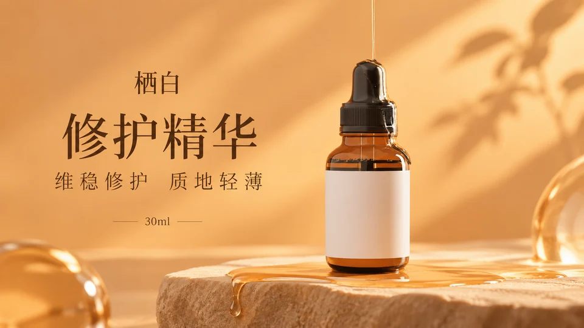</a><br><sub>品牌 KV · 16:9 · 1672x941<br>栖白 修护精华 · <a href="assets/examples/sources/product-qibai-serum.jpg">商品图</a> + <a href="assets/examples/sources/logo-qibai.png">Logo</a> · 文案方案（中文）</sub></p>

### 能做哪些品类

每格一个品类，点开看大图；下面各段有用途、比例、像素和输入说明。

<table>
<tr><td align="center" valign="top"><a href="assets/examples/c01-category-4x5-1122x1402.png">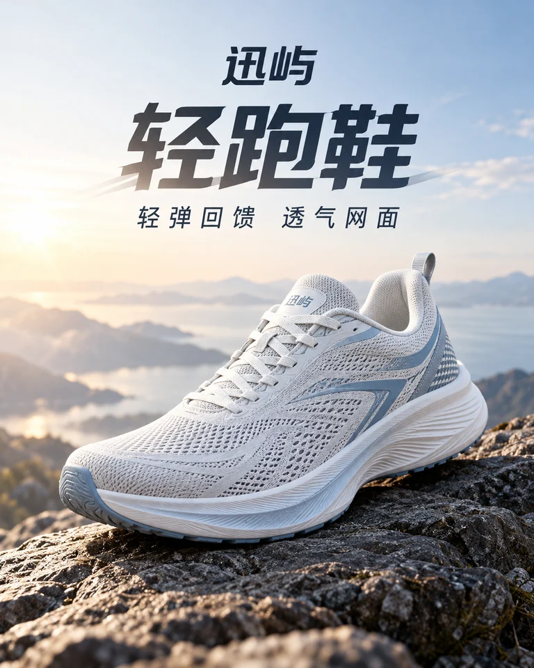</a><br><sub><b>鞋靴</b><br>高端主图</sub></td><td align="center" valign="top"><a href="assets/examples/c02-category-1x1-1254x1254.png">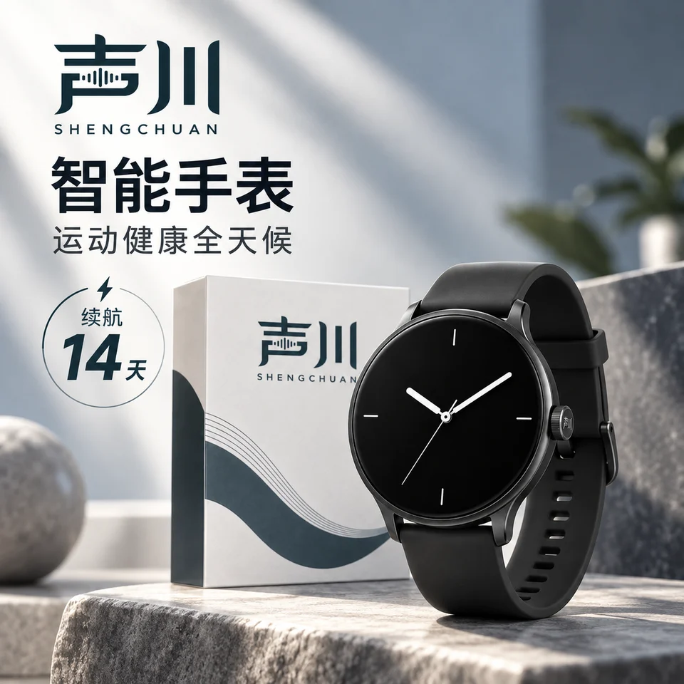</a><br><sub><b>3C 数码</b><br>高端主图</sub></td><td align="center" valign="top"><a href="assets/examples/c03-category-16x9-1672x941.png">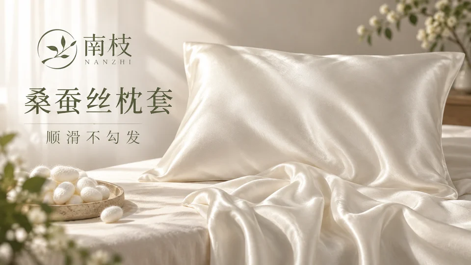</a><br><sub><b>服饰</b><br>品牌 KV</sub></td><td align="center" valign="top"><a href="assets/examples/c04-category-3x4-1086x1448.png">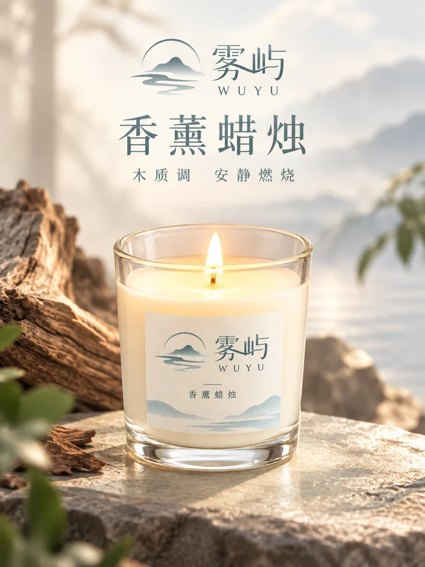</a><br><sub><b>香氛家居</b><br>详情页首屏</sub></td><td align="center" valign="top"><a href="assets/examples/c05-category-1x1-1254x1254.png">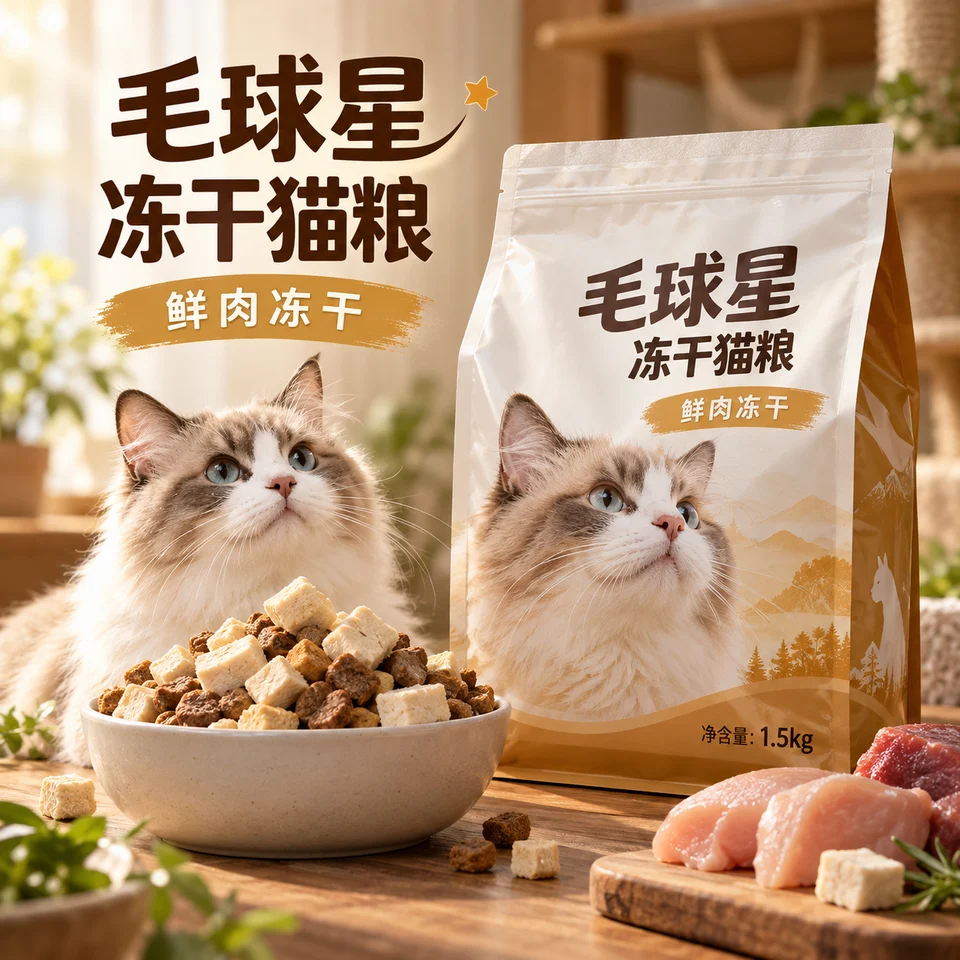</a><br><sub><b>宠物</b><br>高端主图</sub></td><td align="center" valign="top"><a href="assets/examples/c06-category-4x5-1122x1402.png">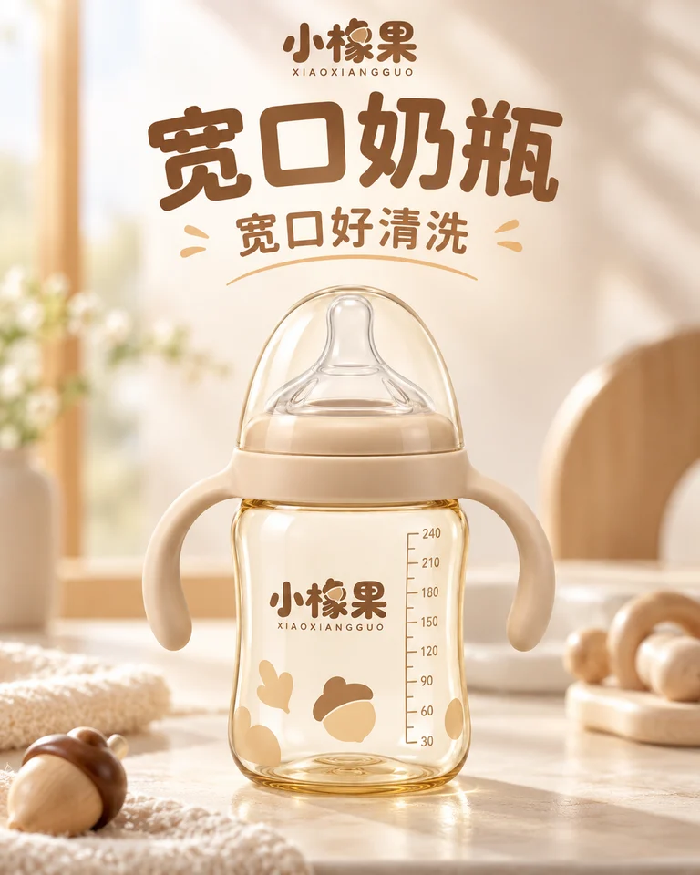</a><br><sub><b>母婴</b><br>社媒</sub></td></tr>
<tr><td align="center" valign="top"><a href="assets/examples/s05-category-3x4-1086x1448.png">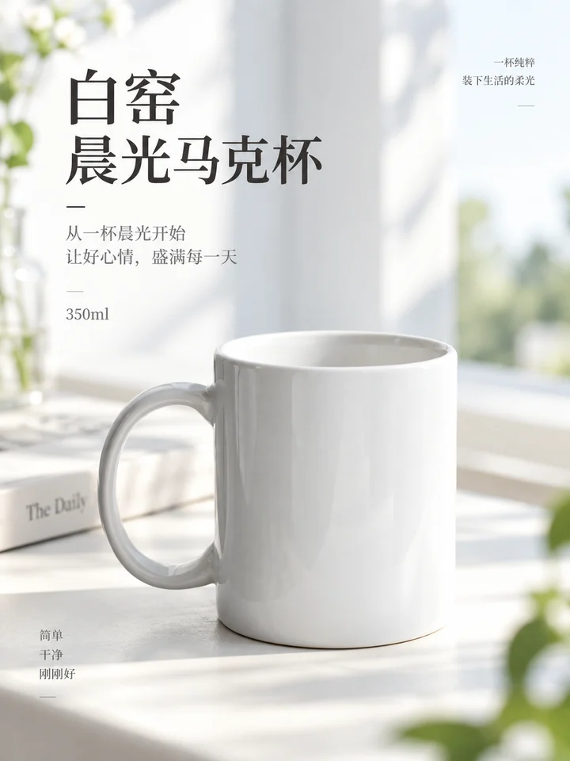</a><br><sub><b>家居</b><br>详情页首屏</sub></td><td align="center" valign="top"><a href="assets/examples/s07-category-16x9-1672x941.png">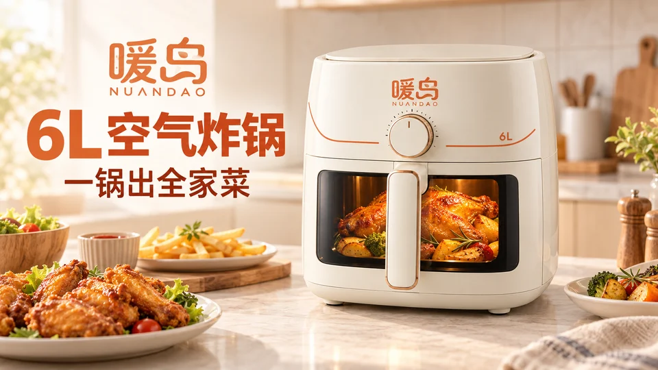</a><br><sub><b>家电</b><br>品牌 KV</sub></td><td align="center" valign="top"><a href="assets/examples/s01-size-1x1-1254x1254.png">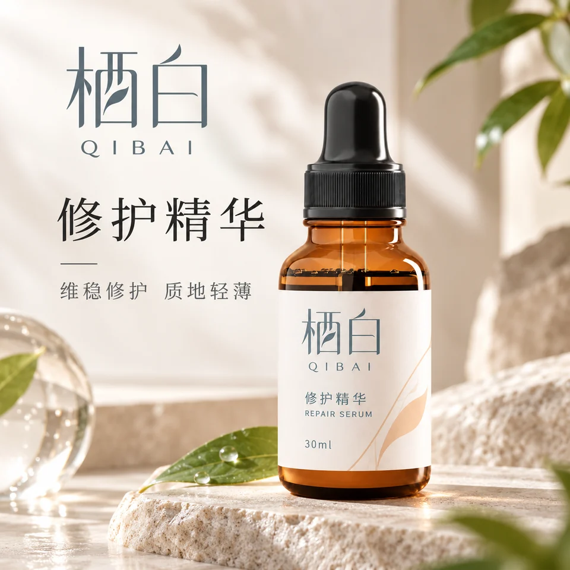</a><br><sub><b>护肤</b><br>高端主图</sub></td><td align="center" valign="top"><a href="assets/examples/s08-special-4x5-1122x1402.png">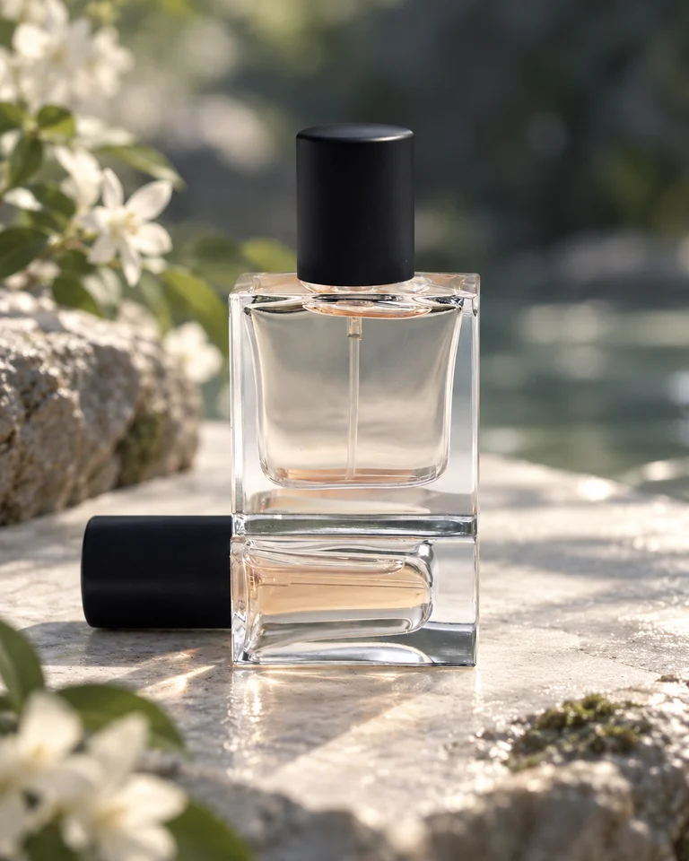</a><br><sub><b>美妆</b><br>社媒</sub></td></tr>
</table>

### 一个商品，适配每个位置

同一商品、同一套风格，每个比例都重新构图，不是裁切。

<table>
<tr><td align="center" valign="top"><a href="assets/examples/s01-size-1x1-1254x1254.png"></a><br><sub>高端主图 · 1:1 · 1254x1254<br>栖白 修护精华 · <a href="assets/examples/sources/product-qibai-serum.jpg">商品图</a> + <a href="assets/examples/sources/logo-qibai.png">Logo</a> · 文案方案（中文）</sub></td><td align="center" valign="top"><a href="assets/examples/s02-size-3x4-1086x1448.png">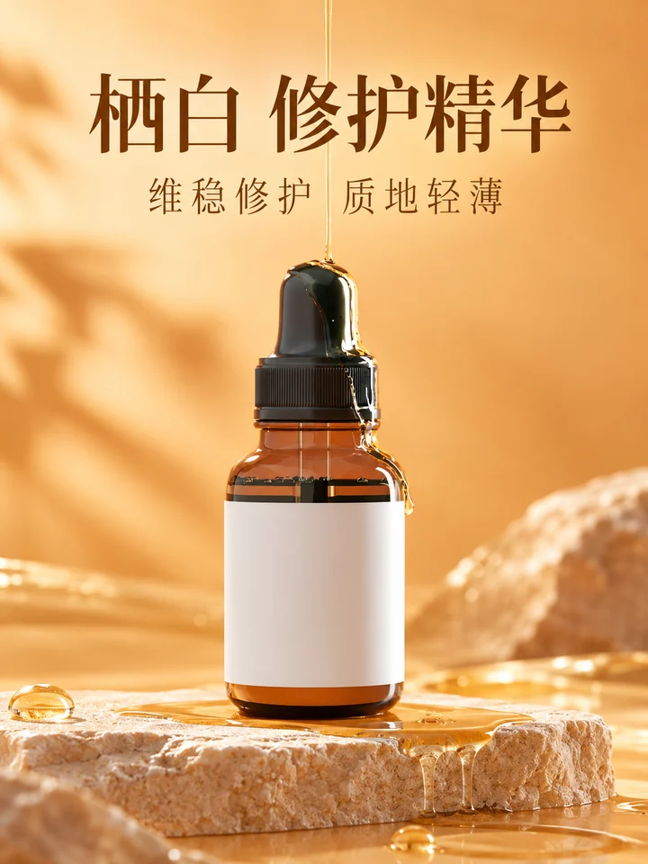</a><br><sub>详情页首屏 · 3:4 · 1086x1448<br>栖白 修护精华 · <a href="assets/examples/sources/product-qibai-serum.jpg">商品图</a> + <a href="assets/examples/sources/logo-qibai.png">Logo</a> · 文案方案（中文）</sub></td><td align="center" valign="top"><a href="assets/examples/s03-size-9x16-940x1672.png">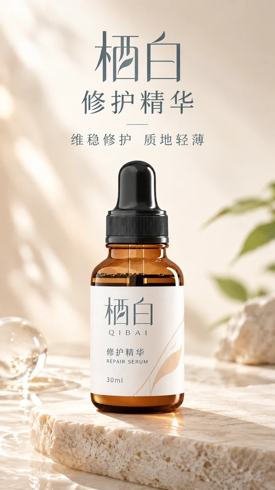</a><br><sub>开屏 · 9:16 · 940x1672<br>栖白 修护精华 · <a href="assets/examples/sources/product-qibai-serum.jpg">商品图</a> + <a href="assets/examples/sources/logo-qibai.png">Logo</a> · 文案方案（中文）</sub></td><td align="center" valign="top"><a href="assets/examples/s04-size-16x9-1672x941.png"></a><br><sub>品牌 KV · 16:9 · 1672x941<br>栖白 修护精华 · <a href="assets/examples/sources/product-qibai-serum.jpg">商品图</a> + <a href="assets/examples/sources/logo-qibai.png">Logo</a> · 文案方案（中文）</sub></td></tr>
</table>

### 换一个品类也成立

<table>
<tr><td align="center" valign="top"><a href="assets/examples/c01-category-4x5-1122x1402.png"></a><br><sub>高端主图 · 4:5 · 1122x1402<br>迅屿 轻跑鞋 · <a href="assets/examples/sources/product-xunyu-shoe.jpg">商品图</a> + <a href="assets/examples/sources/logo-xunyu.png">Logo</a> · 文案方案（中文）</sub></td><td align="center" valign="top"><a href="assets/examples/c02-category-1x1-1254x1254.png"></a><br><sub>高端主图 · 1:1 · 1254x1254<br>声川 智能手表 · <a href="assets/examples/sources/product-sc-watch.jpg">商品图</a> + <a href="assets/examples/sources/logo-shengchuan.png">Logo</a> · 文案方案（中文）</sub></td><td align="center" valign="top"><a href="assets/examples/c03-category-16x9-1672x941.png"></a><br><sub>品牌 KV · 16:9 · 1672x941<br>南枝 桑蚕丝枕套 · <a href="assets/examples/sources/fabric-silk.jpg">原图</a> + <a href="assets/examples/sources/logo-nanzhi.png">Logo</a> · 文案方案（中文）</sub></td></tr>
<tr><td align="center" valign="top"><a href="assets/examples/c04-category-3x4-1086x1448.png"></a><br><sub>详情页首屏 · 3:4 · 1086x1448<br>雾屿 香薰蜡烛 · <a href="assets/examples/sources/product-wuyu-candle.jpg">商品图</a> + <a href="assets/examples/sources/logo-wuyu.png">Logo</a> · 文案方案（中文）</sub></td><td align="center" valign="top"><a href="assets/examples/c05-category-1x1-1254x1254.png"></a><br><sub>高端主图 · 1:1 · 1254x1254<br>毛球星 冻干猫粮 · <a href="assets/examples/sources/product-mqx-catfood.jpg">商品图</a> + <a href="assets/examples/sources/logo-maoqiuxing.png">Logo</a> · 文案方案（中文）</sub></td><td align="center" valign="top"><a href="assets/examples/c06-category-4x5-1122x1402.png"></a><br><sub>社媒 · 4:5 · 1122x1402<br>小橡果 宽口奶瓶 · <a href="assets/examples/sources/product-xxg-bottle.jpg">商品图</a> + <a href="assets/examples/sources/logo-xiaoxiangguo.png">Logo</a> · 文案方案（中文）</sub></td></tr>
<tr><td align="center" valign="top"><a href="assets/examples/s05-category-3x4-1086x1448.png"></a><br><sub>详情页首屏 · 3:4 · 1086x1448<br>白窑 晨光马克杯 · <a href="assets/examples/sources/product-baiyao-mug.jpg">商品图</a> + <a href="assets/examples/sources/logo-baiyao.png">Logo</a> · 模型写字（中文）</sub></td><td align="center" valign="top"><a href="assets/examples/s06-category-1x1-1254x1254.png">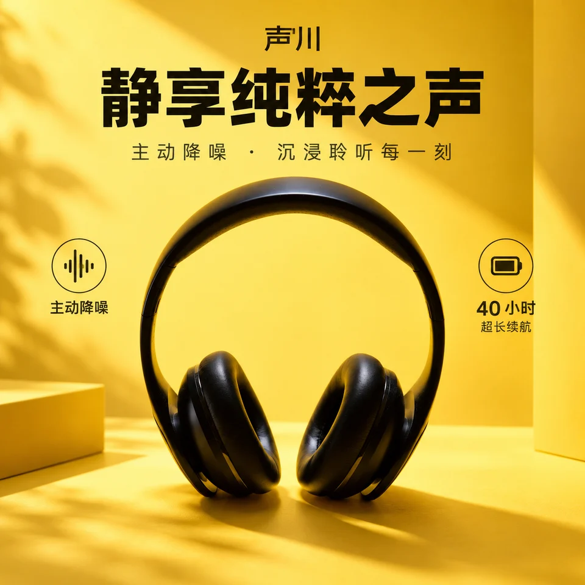</a><br><sub>高端主图 · 1:1 · 1254x1254<br>声川 头戴降噪耳机 · <a href="assets/examples/sources/product-sc-headphones.jpg">商品图</a> + <a href="assets/examples/sources/logo-shengchuan.png">Logo</a> · 模型写字（中文）</sub></td><td align="center" valign="top"><a href="assets/examples/s07-category-16x9-1672x941.png"></a><br><sub>品牌 KV · 16:9 · 1672x941<br>暖岛 6L 空气炸锅 · <a href="assets/examples/sources/product-nuandao-fryer.jpg">商品图</a> + <a href="assets/examples/sources/logo-nuandao.png">Logo</a> · 文案方案（中文）</sub></td></tr>
</table>

### 文字三态：不加字、中文、英文

<table>
<tr><td align="center" valign="top"><a href="assets/examples/s08-special-4x5-1122x1402.png"></a><br><sub>社媒 · 4:5 · 1122x1402<br>雾屿 晨雾淡香水 · <a href="assets/examples/sources/product-wuyu-perfume.jpg">商品图</a> + <a href="assets/examples/sources/logo-wuyu.png">Logo</a> · 不加字</sub></td><td align="center" valign="top"><a href="assets/examples/s09-special-4x5-1122x1402.png">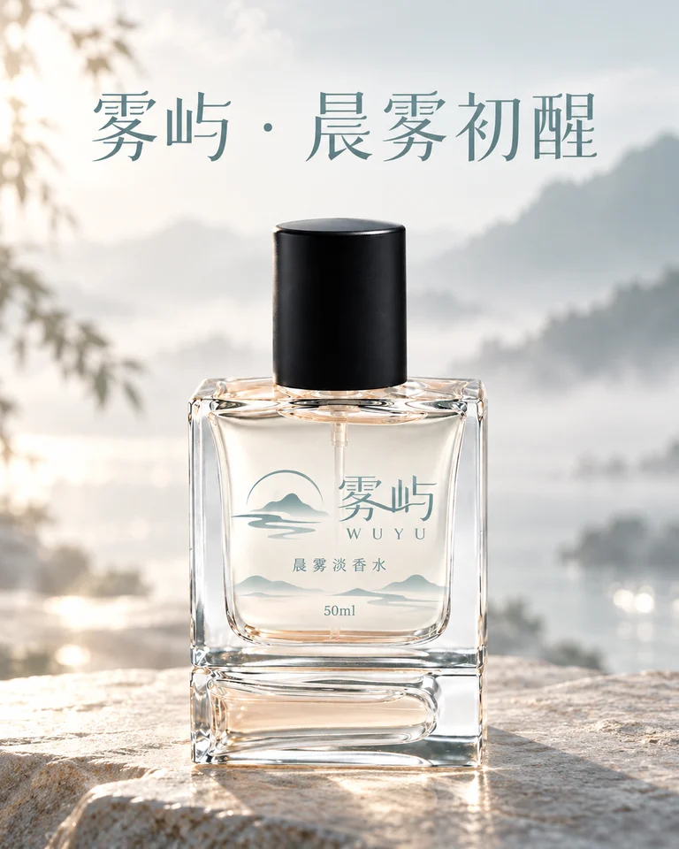</a><br><sub>社媒 · 4:5 · 1122x1402<br>雾屿 晨雾淡香水 · <a href="assets/examples/sources/product-wuyu-perfume.jpg">商品图</a> + <a href="assets/examples/sources/logo-wuyu.png">Logo</a> · 准确文案（中文）</sub></td><td align="center" valign="top"><a href="assets/examples/s10-special-4x5-1122x1402.png">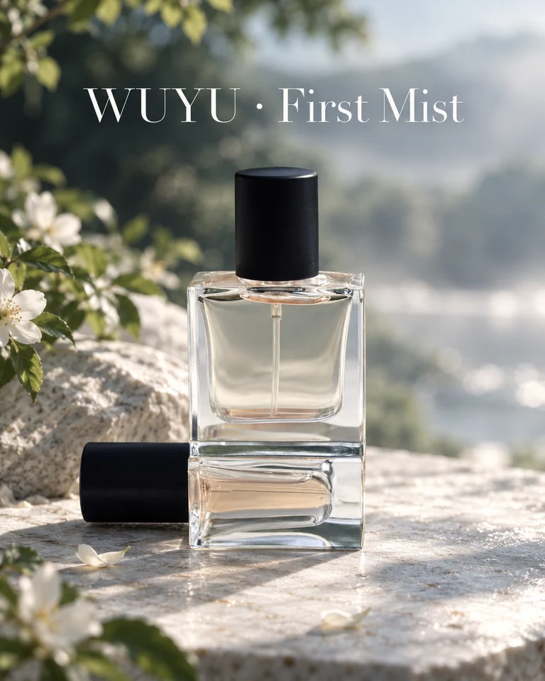</a><br><sub>社媒 · 4:5 · 1122x1402<br>雾屿 晨雾淡香水 · <a href="assets/examples/sources/product-wuyu-perfume.jpg">商品图</a> + <a href="assets/examples/sources/logo-wuyu.png">Logo</a> · 准确文案（英文）</sub></td></tr>
</table>

<sub>样张商品均为虚构的演示品牌，价格、规格等数字为演示设定；演示商品图与 Logo 由本项目生成，部分以 Unsplash 照片为底，署名与许可见 [assets/examples/README.md](assets/examples/README.md)。每张都是单次生成的完整画面，未修图、未拼接、未放大，像素照实标注；没通过目视验收的已重出，不放进来。点开看原尺寸。</sub>

<!-- xxd-samples:end -->

## 它解决什么

很多电商图的问题不是“不够好看”，而是商品像贴上去的：悬浮、平光、廉价展台、背景抢戏、包装上的字被 AI 改错。

**Shop 001** 只做一件事：商品本身不变，光、落点、环境和色彩重新建立，让它像一张成熟品牌拍出来的主视觉。

- **已有商品图，想升级成品牌级主图：** 商品造型、包装文字和 Logo 原样保留。
- **只有商品名称或一个创意命题：** 按品类、材质、使用情境和品牌气质，建立可信的商品和场景。
- **要安静高级，不要促销感：** 背景克制，道具只留真正能说明商品的，标题可有可无。
- **一件商品要多个尺寸：** 主图 1:1、详情页 3:4、开屏 9:16、横幅 16:9，每个比例都重新构图，不是从一张裁出来。

## 和相近的几款怎么选

| 你想要 | 用哪款 |
|---|---|
| 安静、留白、品牌感的主图 | **001**（本款） |
| 大促主图：价格、卖点要一眼看清 | [009 高转化主视觉](https://github.com/nevertoday/xxd-shop-009) |
| 拿现有产品照修成“广告大片”，用光表现功能 | 011 产品视觉重构 |

## 你需要准备

- **商品图**（推荐）：能看清完整外观的一张就够，再加细节图或多角度图更稳。
- **或者商品名称**：没有图也能做，会按品类和材质建立商品形态。
- **用途**（推荐）：“电商主图”“详情页首屏”“品牌 KV”，它会据此推荐尺寸。
- **价格、规格、产地**（可选）：想写上画面就告诉它，没给的不会出现。

## 怎么用

### 第一步：安装（只需一次）

```bash
git clone https://github.com/nevertoday/xxd-shop-001.git
mkdir -p ~/.claude/skills
ln -s "$(pwd)/xxd-shop-001" ~/.claude/skills/xxd-shop-001
```

Codex 用户把同一个文件夹链接到 `~/.codex/skills/xxd-shop-001`。装好后重开一次 AI 助手的会话。

### 第二步：用大白话说出你要什么

```text
/xxd-shop-001 这是我的冷萃咖啡，帮我做一张电商主图和一张详情页首屏
/xxd-shop-001 我只有商品名：手工青梅酒，500ml 玻璃瓶，做一张 4:5 的品牌海报，不要文字
/xxd-shop-001 把 ~/Desktop/商品图 里每件商品都做成 1:1 主图
```

不用记参数。没说清的事（比如尺寸、张数），它会一次问齐；第二次用时可以直接沿用上次的设置。

### 第三步：它会这样做

1. 看你的商品图和描述，只问还没定的事；尺寸会按用途推荐比例，并告诉你像素。
2. 每个尺寸都重新构图，不是从一张图裁出来的。
3. 交付前逐张检查：商品有没有被改、字有没有写错、有没有多出你没给的数字。不通过的会告诉你并重做。
4. PNG 存进 `~/Desktop/xxd/xxd-shop-001/` 下新建的任务文件夹，把路径告诉你。

<details>
<summary><strong>进阶：命令参数写法（熟练后再看）</strong></summary>

```text
/xxd-shop-001 ~/Desktop/商品/冷萃咖啡.png --use 电商主图 --size 1:1,3:4 --text prompt --locale zh-CN
```

#### 参数速查

| 参数 | 作用 |
|---|---|
| `--product "..."` | 商品名称、品类或创意命题；没有商品图时它就是创作依据 |
| `--use "..."` | 用途：电商主图、详情页、海报、品牌 KV、小红书、横幅…… |
| `--size` | `auto`、`source`、`1:1`、`3:4`、`9:16`、`16:9`…或 `宽x高`，可多选 |
| `--count N` | 每个尺寸生成几张独立构图，默认 1 |
| `--text prompt / exact / plan / none` | 模型按这套风格生成文字 / 逐字用你的文案 / 把你的文案当方案理顺层级 / 不加文字 |
| `--copy "..."` | 你的文案；默认逐字使用，配 `--text plan` 时作为文案方案 |
| `--facts "..."` | 允许上画面的事实，例如价格、规格、产地 |
| `--locale` | 画面文字语言，例如 `zh-CN`、`en-US`、`ja-JP` |
| `--logo` / `--ref 路径=用途` | 品牌标识图 / 带明确用途的参考图 |
| `--out` | 输出根目录 |
| `--prefs last / edit / new / off / clear` | 沿用、修改、忽略、不保存或清除上次的交付偏好 |

#### 按用途复制命令

```text
# 有商品图：主图 + 详情页两种完整构图，中文文字由模型按这套风格决定
/xxd-shop-001 ./商品.png --use 电商主图 --size 1:1,3:4 --text prompt --locale zh-CN

# 只有商品名称：按品类与气质建立商品形态，不要文字
/xxd-shop-001 --product "手工青梅酒 · 500ml 玻璃瓶" --size 4:5 --text none

# 固定文案 + 用户提供的事实
/xxd-shop-001 ./商品.png --size 3:4 --copy "山野青梅 慢酿一季" --facts "500ml；酒精度 12%vol" --locale zh-CN

# 同一尺寸出三张独立构图来挑
/xxd-shop-001 ./商品.png --size 1:1 --count 3 --text none

# 整个商品图目录，每张图一件商品，公共设置只问一次
/xxd-shop-001 ~/Desktop/商品图/ --use 电商主图 --size 1:1 --text prompt --locale zh-CN
```

完整规范：

- [Skill 工作流](SKILL.md)
- [运行说明](references/shop-runtime.md)
- [原始提示词](references/original-prompt/zh-CN.md)

</details>

## 常见问题

**一定要有标题吗？**

不用。这套风格本来就允许没有标题；想要固定的一句话，直接告诉它原文，它会一字不改地用。

**需要什么才能用？**

三样东西：① 一个支持 Skills 的 AI 助手，比如 Claude Code 或 Codex；② 一个能出图的模型，可以是助手自带的出图能力，也可以是在 Codex 里配置好的、通过 Responses 接口出图的模型供应商（默认用 GPT Image 2）；③ 电脑上装有 Python 3.11 以上和 Pillow（`pip install pillow`）。

**要花钱吗？能商用吗？**

Skill 本身免费下载，出图费用由你自己的模型账户承担。本项目采用 PolyForm 非商业许可：个人学习、研究、测试可以直接用；用于店铺经营、接单交付等商业用途，需要先取得作者的书面授权，见文末“许可证”。

**出来的图有多大？**

你可以指定比例或准确像素。实际像素以模型返回为准，不会偷偷放大冒充高清，文件名里写的就是真实像素。

**图里的字会写错吗？**

AI 出图偶尔会写错字，或在品牌名旁多出 ® 这类小符号。交付前会逐张放大检查，发现问题就重做那一张；本页的样张都过了这一步。

**会不会乱写价格、销量？**

不会。画面上像事实的内容（价格、规格、产地、销量、获奖、认证……）只来自你提供的信息或商品图上看得清的字；没给就不写，也不放“¥XX”这种占位。

**能一次处理很多商品吗？**

能。把商品图文件夹交给它，每张图当作一件商品，尺寸和文字设置只问一次；每件商品的信息和文案互不串用。

## 它的原则

- **风格不走样：** 这款背后是一份成熟的商业设计提示词（[设计原文](references/original-prompt/zh-CN.md) · [English](references/original-prompt/en.md)）。Skill 不改写它，也不另加配色和美术指导，只把你的商品、尺寸、文字和事实交给模型。
- **商品不改款：** 有商品图时，造型、颜色、包装文字和 Logo 以图为准。
- **只用你给的事实，** 每件商品各管各的，不借用别的商品、旧成品或样张里的内容。
- **交付真实的 PNG 位图，** 不用 SVG 或代码绘图冒充；每次调用都新建任务文件夹。

<!-- xxd-shop-tail -->
<details>
<summary><strong>项目结构（给开发者）</strong></summary>

```text
xxd-shop-001/
├── SKILL.md
├── README.md / README.en.md / README.ja.md / README.ko.md / README.ar.md
├── LICENSE
├── agents/openai.yaml
├── assets/examples/
├── scripts/
│   ├── configured_imagegen.py
│   └── shop_preferences.py
└── references/
    ├── shop-runtime.md
    ├── runtime-preferences.md
    ├── sample-workflow.md
    └── original-prompt/
        ├── README.md
        ├── zh-CN.md
        └── en.md
```

</details>

<!-- xxd-readme-ads:start -->
## 关于 XXD

XXD 是小小东品牌名的缩写，本项目由小小东创建并维护：[@xiaoxiaodong01](https://x.com/xiaoxiaodong01)。

## 小小东多端会员 · 699 元/年

> **广告与商业信息声明：** 以下二维码、会员与付费服务链接属于小小东的广告信息。是否扫码或购买完全自愿，不影响本开源项目的访问与使用。

一次年费，同时开通三项会员权益：**知识星球 + 小小东成员提示词库 + 全部 将军总指挥 Skills 会员**。三项权益合并在同一份会员中，无需分别购买。

<!-- xxd-shop-command-system:start -->

### Skills 如何协作

| 层级 | 包含内容 | 用途 |
|---|---|---|
| **General** | `xxd-shop-all` | 识别可用的编号 Skills，按商品、用途和画面需求推荐，并组织多风格试稿与批量任务。 |
| **Soldier** | `xxd-shop-NNN` | 每个编号执行自己的原始提示词与审美，完成 General 分派的具体任务。 |

<!-- xxd-shop-command-system:end -->

### 会员权益

1. **微信一对一 AI 学习与项目答疑**
   扫描下方二维码，添加小小东微信，围绕 AI 学习、工具使用和实际项目进行一对一沟通，获得答疑与建议；代表性问题将整理为会员内容。
2. **持续更新的成员提示词库**
   [小小东成员提示词库](https://vip.xiaoxiaodong.ai/)当前约有 3.2 万条提示词，会持续整理和扩充，目标超过 10 万条。
3. **全部 将军总指挥 Skills 与使用答疑**
   一份会员覆盖全部 将军总指挥 Skills；使用过程中遇到问题，可以获得相应的使用说明与答疑。
4. **高频刚需优先处理**
   会员提出的高频、刚需提示词与 Skills 需求，会优先评估和开发。

### 如何开通

- 可在[成员网站](https://vip.xiaoxiaodong.ai/)自助开通。
- 也可以扫描下方二维码，添加小小东微信，进行一对一沟通并获得开通协助。

<p align="center"><a href="https://xiaoxiaodong.pages.dev/assets/wechat-qr.png"></a></p>
<!-- xxd-readme-ads:end -->

## 许可证

本项目（包括 Skill、提示词、脚本、文档及随附样张）采用 **PolyForm Noncommercial License 1.0.0**。完整法律条文请见 [LICENSE](LICENSE)，官方页面见 <https://polyformproject.org/licenses/noncommercial/1.0.0>。

用人话说：

- 个人可以用于学习、研究、实验、测试、兴趣项目和私人娱乐；慈善机构、教育机构、公共研究/安全/卫生机构、环保组织及政府机构也可以使用。
- 在**非商业目的**下，你可以使用、复制、修改、制作衍生作品并分享；分享时必须同时提供本许可证（或上面的链接）以及作者提供的所有 `Required Notice:` 声明。
- 不允许用于商业产品或服务、收费交付、出售访问权或许可，或任何预期会带来商业应用的用途。需要商业使用时，请先向版权方另行取得书面许可。
- 本协议只授予其中明确写出的著作权许可和有限的专利许可，不授予商标、品牌名称或其他未明确授予的权利，也不能把你的许可再转授给他人。
- 如果收到书面违约通知，须在 32 天内纠正并采取实际补救措施，否则许可会立即终止；就专利侵权提出书面主张也会终止专利许可。
- 内容按“现状”提供，在法律允许的范围内不作任何担保，使用风险和可能的损失由使用者自行承担。
