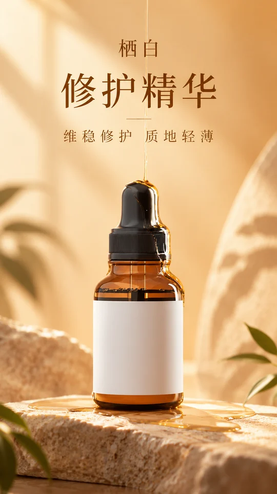

<div align="center">

# 🦁 XXD Shop 001｜高级商业主视觉

### 让商品从自身长出一个安静、真实、有空气感的品牌世界

<strong>简体中文</strong> · <a href="README.en.md">English</a>

</div>

> 原始提示词：[简体中文原文](references/original-prompt/zh-CN.md) · [English](references/original-prompt/en.md)

<!-- xxd-samples:start -->
## 样张

<p align="center"><a href="assets/examples/s04-size-16x9-1672x941.png"></a><br><sub>品牌 KV · 16:9 · 1672x941<br>栖白 修护精华 · <a href="assets/examples/sources/serum-amber.jpg">原图</a> · 文案方案（中文）</sub></p>

### 一个商品，适配每个位置

同一商品、同一份原稿，每个比例都重新构图，不是裁切。

<table>
<tr><td align="center" valign="top"><a href="assets/examples/s01-size-1x1-1254x1254.png"></a><br><sub>高端主图 · 1:1 · 1254x1254<br>栖白 修护精华 · <a href="assets/examples/sources/serum-amber.jpg">原图</a> · 文案方案（中文）</sub></td><td align="center" valign="top"><a href="assets/examples/s02-size-3x4-1086x1448.png"></a><br><sub>详情页首屏 · 3:4 · 1086x1448<br>栖白 修护精华 · <a href="assets/examples/sources/serum-amber.jpg">原图</a> · 文案方案（中文）</sub></td><td align="center" valign="top"><a href="assets/examples/s03-size-9x16-941x1672.png"></a><br><sub>开屏 · 9:16 · 941x1672<br>栖白 修护精华 · <a href="assets/examples/sources/serum-amber.jpg">原图</a> · 文案方案（中文）</sub></td><td align="center" valign="top"><a href="assets/examples/s04-size-16x9-1672x941.png"></a><br><sub>品牌 KV · 16:9 · 1672x941<br>栖白 修护精华 · <a href="assets/examples/sources/serum-amber.jpg">原图</a> · 文案方案（中文）</sub></td></tr>
</table>

### 换一个品类也成立

<table>
<tr><td align="center" valign="top"><a href="assets/examples/s05-category-3x4-1086x1448.png"></a><br><sub>详情页首屏 · 3:4 · 1086x1448<br>白窑 晨光马克杯 · <a href="assets/examples/sources/mug-white.jpg">原图</a> · 按原稿生成（中文）</sub></td><td align="center" valign="top"><a href="assets/examples/s06-category-1x1-1254x1254.png"></a><br><sub>高端主图 · 1:1 · 1254x1254<br>声川 头戴降噪耳机 · <a href="assets/examples/sources/headphones-black.jpg">原图</a> · 按原稿生成（中文）</sub></td><td align="center" valign="top"><a href="assets/examples/s07-category-16x9-1672x941.png"></a><br><sub>品牌 KV · 16:9 · 1672x941<br>暖岛 6L 空气炸锅 · 仅商品名称 · 文案方案（中文）</sub></td></tr>
</table>

### 文字三态：不加字、中文、英文

<table>
<tr><td align="center" valign="top"><a href="assets/examples/s08-special-4x5-1122x1402.png"></a><br><sub>社媒 · 4:5 · 1122x1402<br>雾屿 晨雾淡香水 · <a href="assets/examples/sources/perfume-square.jpg">原图</a> · 不加字</sub></td><td align="center" valign="top"><a href="assets/examples/s09-special-4x5-1122x1402.png"></a><br><sub>社媒 · 4:5 · 1122x1402<br>雾屿 晨雾淡香水 · <a href="assets/examples/sources/perfume-square.jpg">原图</a> · 准确文案（中文）</sub></td><td align="center" valign="top"><a href="assets/examples/s10-special-4x5-1122x1402.png"></a><br><sub>社媒 · 4:5 · 1122x1402<br>雾屿 晨雾淡香水 · <a href="assets/examples/sources/perfume-square.jpg">原图</a> · 准确文案（英文）</sub></td></tr>
</table>

<sub>样张商品均为虚构的演示品牌，价格、规格等数字为演示设定；商品原图来自 Unsplash，署名与许可见 [assets/examples/README.md](assets/examples/README.md)。每张都是单次生成的完整画面，未修图、未拼接、未放大，像素照实标注；没通过目视验收的已重出，不放进来。点开看原尺寸。</sub>

<!-- xxd-samples:end -->

## 适用场景与解决的问题

很多电商图的问题不是“不够好看”，而是商品像贴上去的：悬浮、平光、廉价展台、背景抢戏、包装文字被模型改错。

**Shop 001** 解决的是这件事：商品本身不变，光、落点、环境和色彩重新建立，让它像一张成熟品牌拍出来的主视觉。

### 适合这些情况

- **已有商品图，想升级成品牌级主图：** 白底图、实拍图、包装图都可以；商品造型、包装文字和 Logo 原样保留。
- **只有商品名称或一个创意命题：** 按品类、材质、使用情境和品牌气质建立可信的商品形态与视觉世界。
- **要安静高级，不要促销感：** 背景克制，道具只留真正能解释商品的，标题可有可无。
- **一套商品要多个尺寸：** 主图 1:1、详情页 3:4、开屏 9:16、横幅 16:9，每个比例都是独立的完整构图。

### 快速开始

发一张商品图给 Agent，然后说：

> 用 XXD Shop 001 做这款商品的电商主图，先推荐合适的尺寸。

## 快速判断：XXD Shop 001 适合你吗？

| 你关心的问题 | 这套风格给你的回答 |
|---|---|
| **你会得到什么** | 一张成熟品牌级的电商主图、产品海报或品牌 KV |
| **一眼可辨的特点** | 商品有重量 · 真实落点与接触阴影 · 柔和定向光 · 环境色从商品长出 · 克制留白 · 可选的大字标题 |
| **它如何尊重你的输入** | 商品图是最高依据：造型、比例、包装文字、Logo 不改；只重建光线、阴影、反射与环境 |
| **它不会做什么** | 不编造价格、规格、销量、认证；不加廉价展台、无意义装饰和满屏促销标签 |

## 使用窍门

- **商品图越清楚越好：** 一张能看清完整外观的主图，再加细节图或多角度图更稳。
- **说清用途：** “电商主图”“详情页首屏”“品牌 KV”会影响推荐画幅。
- **事实自己给：** 价格、规格、产地这类信息用 `--facts` 写明，画面只会用你给的。
- **标题可以不要：** 这套风格本来就允许无标题；想要固定文案用 `--copy`。
- **先单张试，再批量：** 先用一件商品确认尺寸和文字，再把整个商品图目录交给它。

## 开始使用

```bash
git clone https://github.com/nevertoday/xxd-shop-001.git
mkdir -p ~/.claude/skills
ln -s "$(pwd)/xxd-shop-001" ~/.claude/skills/xxd-shop-001
```

Codex 用户把同一目录链接到 `~/.codex/skills/xxd-shop-001`。安装后重启 Agent 会话。

```text
/xxd-shop-001 ~/Desktop/商品/冷萃咖啡.png --use 电商主图 --size 1:1,3:4 --text prompt --locale zh-CN
```

只上传商品图也可以调用，Skill 会只问还没确定的尺寸、张数和文字方式。

### 参数速查

| 参数 | 作用 |
|---|---|
| `--product "..."` | 商品名称、品类或创意命题；没有商品图时它就是创作依据 |
| `--use "..."` | 用途：电商主图、详情页、海报、品牌 KV、小红书、横幅…… |
| `--size` | `auto`、`source`、`1:1`、`3:4`、`9:16`、`16:9`…或 `宽x高`，可多选 |
| `--count N` | 每个尺寸生成几张独立构图，默认 1 |
| `--text prompt / exact / plan / none` | 模型按原稿生成文字 / 逐字用你的文案 / 把你的文案当方案理顺层级 / 不加文字 |
| `--copy "..."` | 你的文案；默认逐字使用，配 `--text plan` 时作为文案方案 |
| `--facts "..."` | 允许上画面的事实，例如价格、规格、产地 |
| `--locale` | 画面文字语言，例如 `zh-CN`、`en-US`、`ja-JP` |
| `--logo` / `--ref 路径=用途` | 品牌标识图 / 带明确用途的参考图 |
| `--out` | 输出根目录 |
| `--prefs last / edit / new / off / clear` | 沿用、修改、忽略、不保存或清除上次的交付偏好 |

### 按用途复制命令

```text
# 有商品图：主图 + 详情页两种完整构图，中文文字由模型按原稿决定
/xxd-shop-001 ./商品.png --use 电商主图 --size 1:1,3:4 --text prompt --locale zh-CN

# 只有商品名称：按品类与气质建立商品形态，不要文字
/xxd-shop-001 --product "手工青梅酒 · 500ml 玻璃瓶" --size 4:5 --text none

# 固定文案 + 用户提供的事实
/xxd-shop-001 ./商品.png --size 3:4 --copy "山野青梅 慢酿一季" --facts "500ml；酒精度 12%vol" --locale zh-CN

# 同一尺寸出三张独立构图来挑
/xxd-shop-001 ./商品.png --size 1:1 --count 3 --text none

# 整个商品图目录，每张图一件商品，公共设置只问一次
/xxd-shop-001 ~/Desktop/商品图/ --use 电商主图 --size 1:1 --text prompt --locale zh-CN
```

完整规范：

- [Skill 工作流](SKILL.md)
- [家族运行合同](references/shop-runtime.md)
- [原始提示词](references/original-prompt/zh-CN.md)

## 原始提示词优先，而不是二次导演

`references/original-prompt/zh-CN.md` 逐字保存原始提示词，是唯一的创作与审美权威。Skill 不另做配色、不预写标题、不加美学动机；它只负责告诉图像模型“这次是哪件商品、哪张图是什么角色、哪些事实能用、要什么尺寸和文字”。

## 边界与信任

- 每件商品只在自己的任务里使用，不借用其他商品、旧成品或样张里的内容、文案和构图。
- 画面上看起来像事实的信息（价格、规格、产地、功效、销量、排名、奖项、认证、日期）只来自你提供的、商品图上清楚可读的，或本次核实过的；没有就不写。
- 每次调用都新建任务目录；相同输入和参数也会重新生成。
- 交付 PNG 位图，不用 SVG、HTML 或程序绘图代替。
- 作图只走 `responses` 模式，不走按张计费的 credit 路径；开工前问一次用哪条线路。桥接脚本不打印密钥、请求头、提示词或响应正文。

生图需要主机 Agent 的内置位图能力，或已配置的兼容通道（默认首选 GPT Image 2）。安全位图桥接需要 Python 3.11+ 与 Pillow。

<!-- xxd-shop-tail -->
## 项目结构

```text
xxd-shop-001/
├── SKILL.md
├── README.md / README.en.md
├── LICENSE
├── agents/openai.yaml
├── assets/examples/
├── scripts/
│   ├── configured_imagegen.py
│   └── shop_preferences.py
└── references/
    ├── shop-runtime.md
    ├── runtime-preferences.md
    ├── sample-workflow.md
    └── original-prompt/
        ├── README.md
        ├── zh-CN.md
        └── en.md
```

<!-- xxd-readme-ads:start -->
## 关于 XXD

XXD 是小小东品牌名的缩写，本项目由小小东创建并维护：[@xiaoxiaodong01](https://x.com/xiaoxiaodong01)。

## 小小东多端会员 · 699 元/年

> **广告与商业信息声明：** 以下二维码、会员与付费服务链接属于小小东的广告信息。是否扫码或购买完全自愿，不影响本开源项目的访问与使用。

一次年费，同时开通三项会员权益：**知识星球 + 小小东成员提示词库 + 全部 将军总指挥 Skills 会员**。三项权益合并在同一份会员中，无需分别购买。

<!-- xxd-shop-command-system:start -->

### Skills 如何协作

| 层级 | 包含内容 | 用途 |
|---|---|---|
| **General** | `xxd-shop-all` | 识别可用的编号 Skills，按商品、用途和画面需求推荐，并组织多风格试稿与批量任务。 |
| **Soldier** | `xxd-shop-NNN` | 每个编号执行自己的原始提示词与审美，完成 General 分派的具体任务。 |

<!-- xxd-shop-command-system:end -->

### 会员权益

1. **微信一对一 AI 学习与项目答疑**
   扫描下方二维码，添加小小东微信，围绕 AI 学习、工具使用和实际项目进行一对一沟通，获得答疑与建议；代表性问题将整理为会员内容。
2. **持续更新的成员提示词库**
   [小小东成员提示词库](https://vip.xiaoxiaodong.ai/)当前约有 3.2 万条提示词，会持续整理和扩充，目标超过 10 万条。
3. **全部 将军总指挥 Skills 与使用答疑**
   一份会员覆盖全部 将军总指挥 Skills；使用过程中遇到问题，可以获得相应的使用说明与答疑。
4. **高频刚需优先处理**
   会员提出的高频、刚需提示词与 Skills 需求，会优先评估和开发。

### 如何开通

- 可在[成员网站](https://vip.xiaoxiaodong.ai/)自助开通。
- 也可以扫描下方二维码，添加小小东微信，进行一对一沟通并获得开通协助。

<p align="center"><a href="https://xiaoxiaodong.pages.dev/assets/wechat-qr.png"></a></p>
<!-- xxd-readme-ads:end -->

## 许可证

本项目（包括 Skill、提示词、脚本、文档及随附样张）采用 **PolyForm Noncommercial License 1.0.0**。完整法律条文请见 [LICENSE](LICENSE)，官方页面见 <https://polyformproject.org/licenses/noncommercial/1.0.0>。

用人话说：

- 个人可以用于学习、研究、实验、测试、兴趣项目和私人娱乐；慈善机构、教育机构、公共研究/安全/卫生机构、环保组织及政府机构也可以使用。
- 在**非商业目的**下，你可以使用、复制、修改、制作衍生作品并分享；分享时必须同时提供本许可证（或上面的链接）以及作者提供的所有 `Required Notice:` 声明。
- 不允许用于商业产品或服务、收费交付、出售访问权或许可，或任何预期会带来商业应用的用途。需要商业使用时，请先向版权方另行取得书面许可。
- 本协议只授予其中明确写出的著作权许可和有限的专利许可，不授予商标、品牌名称或其他未明确授予的权利，也不能把你的许可再转授给他人。
- 如果收到书面违约通知，须在 32 天内纠正并采取实际补救措施，否则许可会立即终止；就专利侵权提出书面主张也会终止专利许可。
- 内容按“现状”提供，在法律允许的范围内不作任何担保，使用风险和可能的损失由使用者自行承担。
